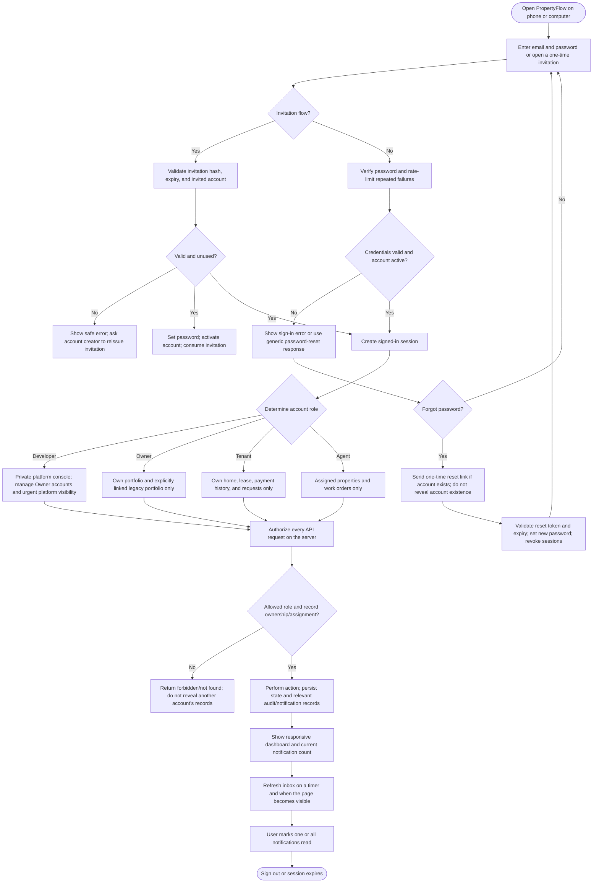
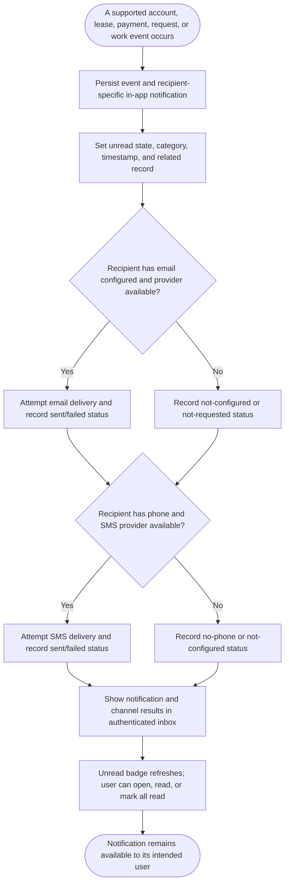

# PropertyFlow final product design

This document is the source of truth for the next development stage. It records the product decisions made with the product owner before the system is taken live.

## 1. The four dashboards

PropertyFlow must present four clear dashboard experiences. Do not create a separate owner dashboard and a separate general admin dashboard for the same property operation.

| Dashboard | Main user | Purpose |
| --- | --- | --- |
| Developer | Platform owner only | Creates customer accounts, controls subscriptions and capacity, sees service health, and provides audited support. It is never available to customers, tenants, caretakers, or agents. |
| Owner | House owner or property manager | Operates their property portfolio: properties, units, rents, tenants, vacancies, requests, and agents. |
| Tenant | A current tenant | Sees only their own lease, bills, payments, home details, and submitted requests. |
| Agent | Primary or backup agent | Sees only assigned visits, inspections, and work orders. |

The owner dashboard is the single property-operations interface. There is no separate delegated-admin account or dashboard.

- **Owner:** Full access to their allocated rent capacity, tenant accounts, payment reports, units, properties, and agents.
- **Caretaker:** Uses the same operational interface but cannot change rent, access payout information, delete records, or see full financial reports unless an owner explicitly grants a finance permission.
- **Finance user, if added later:** Can view invoices, receipts, arrears, and reports, but does not need maintenance or building-operation access.

The developer creates owner accounts directly. Each owner manages their own properties and tenant allocation. Legacy delegated-admin accounts are migrated to the Owner role while preserving their existing login and linked property data; linked owner portfolios remain visible to the converted account. Caretaker permissions remain a separate future feature, not a second owner/admin role.

## 2. The property, unit, and rent model

A property is not enough. The system must have a record for every physical rentable unit.

```text
Property: Maple Court
  └─ Unit: B-12
       ├─ Permanent internal ID: unit_8d42f9...
       ├─ Visible unit code: MC-B-12
       ├─ Standard asking rent: KES 30,000
       ├─ Current lease: Brian Otieno, KES 28,000
       └─ QR token: random and non-guessable
```

Create these records separately:

1. **Property** — name, address, owner organisation, building blocks, and general settings.
2. **Unit** — permanent ID, property ID, unit number, unit type, bedroom count, normal asking rent, vacancy state, and QR token.
3. **Lease** — tenant ID, unit ID, agreed rent, deposit, due day, start date, end date, and state such as active, ending, ended, or renewed.
4. **Invoice/payment** — the exact amount due for a period and the payment or balance against it.

The rent must be attached to the active lease, not only to the house. This protects historical records. A unit can have an asking rent of KES 30,000 while an existing tenant completes an older KES 28,000 lease. When the tenant leaves, the new lease can use the new amount without altering old receipts or reports.

Only the owner can change the agreed rent. A rent change must store an effective date and an audit record showing who made the change. Never edit a paid invoice to reflect a later rent increase.

## 3. Automatic unit identity and QR codes

PropertyFlow must generate unit identity automatically. The platform owner does not manually create codes for every apartment.

When an owner adds a unit, the backend creates:

- an immutable internal `unitId`;
- a human-readable code, for example `MC-B-12`;
- a random QR token; and
- a downloadable/printable label linked to that token.

The unit actions let the owner generate or replace a printable PNG label. Only a hash of the QR token is retained; replacing the label invalidates the previous token. Scanning opens sign-in, and the backend checks the signed-in role and unit assignment before returning any unit or work-order information. Authorized scans are audit logged.

The printed code belongs to the physical unit, not its tenant. It remains with the apartment when a tenant moves out. The printed label must not contain tenant names, rent amounts, phone numbers, payment balances, or lease information.

The QR should resolve to a secure link such as:

```text
https://app.propertyflow.co.ke/unit/q7X9mP2kL...
```

After scanning, the backend identifies the unit and then checks who is signed in. An agent can see the assigned job, a tenant can create a request for their own home, and the owner can see the complete unit record. A public scan must never expose private information.

QR labels are optional for launch. The product must still support searching by property and unit code. When labels are used, the owner, caretaker, or agent downloads the printable sheet and places it on the door, meter box, or building file. PropertyFlow may later offer paid printing and delivery, but distribution is normally the customer’s responsibility.

The system must support QR replacement. If a label is damaged, copied, or incorrectly placed, the owner can deactivate the old token and generate a new one while retaining the permanent unit history.

## 4. Tenant onboarding

Tenants do not find the service on their own. They are invited when they move in.

1. The owner creates or selects the unit.
2. The owner creates the lease and enters the tenant’s name, phone number, email if available, rent, deposit, due date, and lease dates.
3. The system allocates one tenant account from the property organisation’s subscription capacity.
4. The system sends a secure invitation by email, SMS, or WhatsApp.
5. The tenant opens the link, verifies a one-time code or invitation token, sets a password, and reaches their Tenant dashboard.

The invitation must expire, be single-use, and be reissued only by an authorised owner. Tenants should be encouraged to add the web application to their phone home screen.

## 5. Phone-first device strategy

Most users are expected to use a phone. The normal web application must therefore be fully usable on a small touch screen before desktop-specific enhancements are considered. No user should need a desktop to sign in, understand their dashboard, submit or update a request, manage a work order, review a payment, or receive account and system notifications.

The interface must adapt across Android phones, iPhones, tablets, laptops, and desktops:

- Reflow the sidebar into a compact, horizontally scrollable role navigation on small screens; keep the current role and primary actions discoverable.
- Use a single-column content layout on phones, stacked dashboard cards, readable metrics, and forms that fit the viewport without horizontal page scrolling.
- Keep actions and inputs comfortably touchable (at least 42 CSS pixels high), preserve visible keyboard focus, and respect reduced-motion preferences and device safe areas.
- Keep wide rent rolls and reports inside their own horizontally scrollable table containers rather than shrinking text or widening the whole page.
- Show alerts and forms in a viewport-bounded, scrollable panel or bottom sheet; do not hide validation errors or delivery state below an inaccessible overlay.
- Test at narrow phone widths, in portrait and landscape, with long names/content, keyboard focus, and touch navigation.

PropertyFlow is a responsive web app usable in the mobile browser. An installable Progressive Web App (PWA), offline support, and push notifications are future work; do not imply that they are already available.

Do not make Google Play Store or Apple App Store publication a launch requirement. Native apps can be added later after usage proves the need for offline features, push notifications, camera workflow, or a more polished mobile experience.

## 6. End-to-end system flow

The diagrams below describe the complete intended user journey, from platform setup through daily property operations and tenant move-out. Solid flows describe the implemented role, invitation, lease, request, work-order, inbox, and configured M-Pesa behaviors. A production rollout must still configure and test the database and delivery providers; future/externally handled steps are called out instead of being presented as working integrations.

### 6.1 Main journey: platform setup to property operations

```mermaid
flowchart TD
    A([Start: prepare PropertyFlow]) --> B[Confirm production environment, HTTPS URL, secrets, and database backup]
    B --> C{Database reachable and healthy?}
    C -- No --> C1[Stop launch; fix connection and verify health without exposing secrets]
    C1 --> C
    C -- Yes --> D[Create private Developer account]
    D --> E[Developer signs in over HTTPS]
    E --> F[Developer creates Owner account and allocates at least 50 tenant seats and up to 2 agent seats]
    F --> G[Send one-time Owner invitation by configured email or SMS]
    G --> H{Invitation delivered?}
    H -- No / provider unavailable --> H1[Show delivery status and secure invitation link for the Developer to share]
    H1 --> I
    H -- Yes --> I[Owner opens invitation, sets a strong password, and signs in]
    I --> I1{Will the Owner use agents?}
    I1 -- Yes --> I2[Owner invites a primary agent and optional backup within allocated seats]
    I2 --> I3[Agent opens one-time invitation, sets password, and signs in to assigned work only]
    I3 --> J
    I1 -- Not yet --> J
    J[Owner creates property and enters its address and unit capacity]
    J --> K[Owner creates each unit; system assigns a permanent ID, visible code, and vacant status]
    K --> L{Need a QR label?}
    L -- Yes --> L1[Generate printable QR; store token hash; replace old token on rotation]
    L -- No --> M
    L1 --> M[Owner selects a vacant unit and creates a lease]
    M --> N{Tenant seats available?}
    N -- No --> N1[Do not create the tenant; Developer adjusts Owner allocation]
    N1 --> F
    N -- Yes --> O[Record tenant contact, rent, deposit, due day, and lease dates]
    O --> P[Reserve unit, create lease history, and consume one tenant seat]
    P --> Q[Send one-time Tenant invitation]
    Q --> R{Tenant accepts a valid, unexpired invitation?}
    R -- No --> R1[Owner reissues invitation; old invitation token is replaced]
    R1 --> Q
    R -- Yes --> S[Tenant sets password and signs in]
    S --> T[Backend checks session and role; Tenant sees only own home, lease, payments, and requests]
    T --> U{What does the Tenant need to do?}
    U -- Report maintenance or safety issue --> V[Submit issue, location, description, and priority]
    V --> W[Save request and notify Owner team and active assigned-property agents]
    W --> X{High priority?}
    X -- Yes --> X1[Also notify active Developer account for urgent visibility]
    X -- No --> Y[Owner reviews prioritized request]
    X1 --> Y
    Y --> Z{Assign an active agent?}
    Z -- No --> Z1[Keep request visible as received or under review; notify users when it changes]
    Z1 --> Y
    Z -- Yes --> AA[Create/update work order with agent and scheduled time]
    AA --> AB[Notify assigned Agent and Tenant]
    AB --> AC[Agent signs in and sees only work assigned to that Agent]
    AC --> AD[Agent marks work in progress]
    AD --> AE[Notify Tenant and Owner team; update request status]
    AE --> AF{Work complete?}
    AF -- No --> AD
    AF -- Yes --> AG[Agent marks complete; resolve request and save completion time]
    AG --> AH[Notify Tenant and Owner team; notify Developer for high-priority work]
    AH --> AI[Tenant checks resolution; Owner reviews history]
    U -- Review rent or make a payment --> AJ[Show current rent, due date, balance, and payment history]
    AJ --> AK{M-Pesa configured and payment due?}
    AK -- No --> AK1[Show that in-app checkout is unavailable; use separately agreed payment arrangement]
    AK1 --> AL[Wait for a supported payment confirmation or follow up with Owner]
    AK -- Yes --> AM[Request STK push; prevent duplicate pending request for the same rent period]
    AM --> AN{Safaricom callback received and validated?}
    AN -- No --> AO[Leave pending or report provider failure; do not claim payment succeeded]
    AN -- Yes --> AP{Amount and phone match the request?}
    AP -- No --> AQ[Mark for review; notify Owner team and Developer]
    AP -- Yes --> AR[Mark paid once, store receipt, update collection and next due date]
    AR --> AS[Notify Tenant and Owner team with payment outcome]
    U -- Give move-out notice --> AT[Owner records expected date and notice/renewal status]
    AT --> AU[Notify Tenant and retain active lease and unit until move-out is completed]
    AU --> AV{Tenant renews or moves out?}
    AV -- Renews --> AW[Owner records the next lease; preserve old lease and receipts]
    AW --> M
    AV -- Moves out --> AX[Owner completes move-out]
    AX --> AY[End lease, revoke Tenant sessions, free the unit and tenant seat, and update occupancy]
    AY --> AZ([Unit is ready for its next lease])
    AZ --> M
    AI --> BA[Continue property operations; review reports, alerts, and audit history]
    AS --> BA
    AO --> BA
    AL --> BA
    BA --> BB([End of this work cycle; notifications remain in each user's inbox])
```



### 6.2 Sign-in, privacy, and recovery



### 6.3 Notification delivery and work-order lifecycle



The authenticated inbox is the durable in-app record. Email and SMS are best-effort external delivery channels: a failed provider attempt must remain visibly failed and must not be reported as delivered. Notifications are private to the recipient. High-priority tenant requests and their work-order updates also notify the active Developer account; routine activity stays with the relevant Owner team, Tenant, and/or assigned Agent. Browser push notifications, automated retries, notification preferences, and delivery queues are future capabilities, not current guarantees.

### 6.4 Files, payments, reminders, reports, and audit

- Repair photos and lease documents are sent to a private S3-compatible bucket. The API validates file size and content signatures, stores only object metadata in application state, and returns a one-minute signed download URL only after checking the caller’s role and relationship to the request or lease. A storage provider and credentials must be configured before uploads are available.
- Bank and cash payments are recorded for owner review. Confirmed payments receive a PropertyFlow receipt number, update collected rent, advance the next rent date only when the rent period is fully covered, and notify the tenant and owner team. M-Pesa callback payments follow the same receipt and rent-coverage rules. Confirmation is not a substitute for checking the bank statement or provider settlement.
- Owners can choose the rent reminder offsets and lease-expiry lead times. A 15-minute scheduler records delivery outcomes and deduplication keys so a reminder is not repeatedly sent for the same tenant, due date, and offset. External delivery still depends on configured email or SMS providers.
- Owners and the Developer can export role-scoped rent, arrears, occupancy, maintenance, and lease-expiry CSV reports. The server escapes formula-leading text values before creating the download.
- Owner and Developer audit history records key account, lease, rent, request, work-order, document, payment, and QR events with actor, time, and related record identifiers. It is not an immutable external audit ledger.

### 6.5 Laptop offline mode and hosted online mode

The Windows laptop runs PropertyFlow as a local web service at `127.0.0.1:3000` with its own local JSON store. The installed web app caches only the static interface, icon, and graphical flowchart. Authenticated API responses and private records are not put in the browser cache. The Node service must be running to sign in or read/write local records; the Windows Startup shortcut starts it at account sign-in.

Laptop and Render data are separate and do not synchronize. Treat them as two independent environments until a deliberate, conflict-safe synchronization design is built. Email, SMS, M-Pesa, and S3-compatible file operations depend on internet access and their provider credentials; the local screens and local-data workflows remain on the laptop.

The graphical high-level workflow is available as `frontend/flowchart.svg` in the local app at `/flowchart.svg`. The detailed lifecycle, access/recovery, and notification diagrams below remain Mermaid flowcharts in this document and render graphically in a Markdown preview.

The public document index is available at `/documents` and serves only the legal and customer-facing files committed under `docs/legal/`. Internal operations and technical documents are kept outside the public web root. These documents remain drafts until their placeholders and legal-review markers are completed.

Each signed-in role receives a workflow guide linked to the full chart. Work-order progress is enforced by the API: open or scheduled jobs must be started before completion, completed jobs cannot be reopened, and an assigned job cannot be reassigned after work starts. Other lifecycle actions retain their role-specific review, verification, and notification paths.

## 7. Access and subscription capacity

The developer creates the property owner account. The allocation belongs to that owner’s property portfolio.

The initial product rule is at least 50 tenant accounts for an owner account created by the developer. The owner uses those accounts to invite tenants. Caretakers and agents do not consume tenant capacity.

Each paid property organisation includes two agent accounts by default: primary and backup. Additional agent accounts may be a paid add-on later.

## 8. Next implementation checklist

- [x] Consolidate property owner and delegated-admin operations into one Owner role; migrate existing admin-role accounts without removing their logins or property data.
- [x] Add per-user notifications for developer, owner, agent, and tenant workflows, with persisted unread/read state and email/SMS delivery reporting.
- [x] Add responsive phone and tablet layouts, touch-sized controls, and small-screen navigation for core account workflows.
- [x] Add unit and lease collections; legacy tenant records receive a best-effort unit/lease migration when loaded.
- [x] Add a unit creation form with asking rent, unit type, and generated unit code.
- [x] Add QR-token creation, secure role-checked resolution, printable label download, token rotation, and scan audit logs.
- [x] Add a unit rent roll showing unit, tenant, agreed rent, due date, paid amount, and balance.
- [x] Add an owner-only rent-change workflow with an effective date and audit history.
- [x] Add private S3-compatible repair-photo and lease-document uploads with relationship-checked, short-lived download links.
- [x] Add owner-reviewed bank/cash reconciliation and receipts; share rent-coverage logic with the M-Pesa callback flow.
- [x] Add configurable rent and lease reminders with delivery history and duplicate suppression.
- [x] Add scoped CSV exports for rent, arrears, occupancy, maintenance, and lease expiry.
- [x] Add owner/Developer audit history for key account, lease, payment, file, request, work-order, and QR actions.
- [x] Add browser workflow tests for tenant requests, owner report downloads, agent work updates, and phone-sized layout.
- [ ] Add restricted caretaker permissions and test that caretaker accounts cannot access finance routes.
- [x] Add tenant invitations via the configured email/SMS provider; consider WhatsApp if adopted.
- [x] Add an installable web app, offline-cached static shell/flowchart, and keep private API data out of the service-worker cache.
- [ ] Add provider retry/queue operations, notification preferences, and browser push notifications.
- [ ] Keep M-Pesa in sandbox until payment callbacks, reconciliation, receipts, and failed-payment cases are tested.
